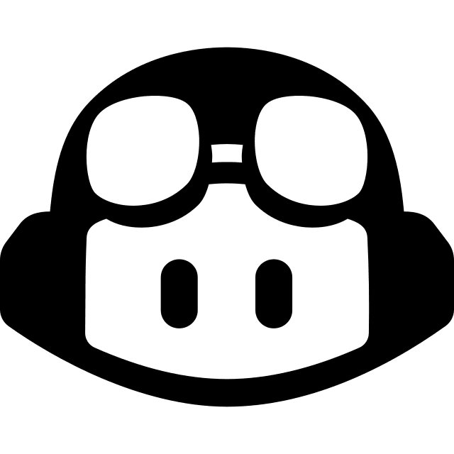

# OIAP - Open Interoperable Agent Plugins


<p>
	<strong>Write your AI agent plugin in TypeScript once and convert to:</strong>
</p>

<table>
	<tr>
		<td align="center" valign="middle"> Claude Code</td>
		<td align="center" valign="middle"> Codex</td>
		<td align="center" valign="middle"> VS Code Copilot</td>
		<td align="center" valign="middle"> Cursor</td>
		<td align="center" valign="middle">Cline</td>
		<td align="center" valign="middle">Windsurf</td>
		<td align="center" valign="middle"> OpenClaw</td>
		<td align="center" valign="middle"> Google Antigravity</td>
	</tr>
	<tr>
		<td colspan="8" align="center"><strong>and many more...</strong></td>
	</tr>
</table>

OIAP is a TypeScript SDK and build toolchain for writing AI agent plugins once
and exporting them into host-native bundles for multiple agent platforms.

Agent harnesses increasingly expose the same ideas through different file
formats: commands, skills, rules, hooks, custom agents, MCP configuration,
runtime shims, and permission policies. OIAP gives plugin authors one stable
authoring model and a set of exporters that generate reviewable bundles for each
target platform.

## Project Status

**⚠️ OIAP is early and actively evolving.** The current repository focuses on developer
tooling: define plugins, normalize them into an intermediate representation,
generate bundle artifacts, and install selected bundles into known local or
global target directories when an installer path is defined.

## Features

- **Host-neutral TypeScript authoring** for plugin manifests, commands,
	instructions, skills, hooks, agents, tools, artifacts, recipes, and policies.
- A published Node **CLI that builds plugin definition files** into deterministic
	target bundle directories.
- Exporters that **render OIAP plugins into host-native files** for the currently
	implemented agent platforms.
- A **stable runtime for hooks** and executable scripts, giving generated adapters a
	consistent way to invoke plugin behavior across host environments.
- **Compatibility reports** that describe which capabilities mapped cleanly,
	degraded, or were unsupported for a target.

OIAP is complementary to specification efforts such as the
[Open Plugin Spec](https://github.com/vercel-labs/open-plugin-spec). It is not a
competing standards body; it is practical authoring and bundling infrastructure
for developers who need to ship across several agent harnesses.

## Quick Start

The `@oiap/cli` package is published to npm as a Node CLI and installs the
`oiap` binary. In a plugin project, install the CLI with the authoring SDK:

```sh
npm install --save-dev @oiap/cli @oiap/core
```

List the registered exporter targets:

```sh
npx oiap targets
```

Create an `oiap.plugin.ts` file using the shape shown below, then build it for a
target platform:

```sh
npx oiap build oiap.plugin.ts --target claude-code --out dist/claude-code
```

Build the same plugin for every registered exporter:

```sh
npx oiap build oiap.plugin.ts --out dist/oiap
```

## Two Ways to Ship a Plugin

You write the plugin once in `oiap.plugin.ts`. How users get it depends on the
host:

| | Commit host files with `oiap sync` | Build at install time with `install-agent-plugin` |
| --- | --- | --- |
| How it works | You run `oiap sync` and commit the generated host files; the [OIAP GitHub Action](#commit-host-files-with-oiap-sync) fails pull requests when they are out of date. | Users run `npx install-agent-plugin owner/repo --agent <target>`, which builds the bundle from your source on their machine. You can also wrap it in your own CLI with `installPlugin()`. |
| Users install with | Each host's own command: `claude plugin marketplace add owner/repo`, `codex plugin marketplace add`, `copilot plugin marketplace add`, `gemini extensions install`, `agy plugin install` | `install-agent-plugin`, or your CLI |
| Updates | The host's own update, from your default branch | Users run the installer again |
| Best for | Hosts that install from git: Claude Code, Codex, Cursor, Gemini CLI, GitHub Copilot CLI, VS Code Copilot, Antigravity, OpenClaw | Hosts that read files from the user's project: Cline, Windsurf, OpenCode; installing into a specific project or user directory |

Most plugins use both: commit synced files so each host's native install works,
and document `install-agent-plugin` for project-local hosts. See
[Distribute Your Plugin](#distribute-your-plugin).

## Agent Skill

🤯 Agents write plugins for agents. The [create-plugin skill](skills/create-plugin)
helps agents scaffold OIAP plugin projects, write `oiap.plugin.ts` files, choose
primitives, and build bundles with the npm-published OIAP CLI.

Install it with:

```sh
npx skills add fboldo/oiap --skill create-plugin
```

## Plugin Example

An OIAP plugin is a normal TypeScript module that exports a `definePlugin`
definition. The CLI loads that definition and asks the selected exporters to
render platform-specific files.

```text
my-review-plugin/
  oiap.plugin.ts
  prompts/
    review.md
```

```md
<!-- prompts/review.md -->
Review the current change for correctness, security risks, missing tests, and
maintainability issues. Lead with concrete findings and include file references
when possible.
```

```ts
import type { PluginDefinition } from "@oiap/core";
import { definePlugin, markdownFile } from "@oiap/core";

const reviewPrompt = markdownFile("prompts/review.md", {
	baseUrl: import.meta.url,
});

export default definePlugin({
	manifest: {
		id: "review-guard",
		name: "Review Guard",
		version: "1.0.0",
		description:
			"Adds a portable review command for agent-assisted code review.",
		license: "MIT",
		categories: ["review", "quality", "commands"],
		supportedTargets: ["claude-code", "codex", "vscode-copilot-chat"],
	},
	invocations: [
		{
			id: "review-guard-invocation",
			canonical: "review-guard",
			targetAliases: {
				"claude-code": "review-guard",
				codex: "review-guard",
				"vscode-copilot-chat": "review-guard",
			},
			helpText: "Review the current change before it is merged.",
			examples: ["/review-guard", "/review-guard Focus on security"],
		},
	],
	instructions: [
		{
			id: "review-guard-prompt",
			purpose: "command",
			triggers: ["review", "code review", "pre-merge review"],
			body: reviewPrompt,
		},
	],
	commands: [
		{
			id: "review-guard-command",
			invocation: { id: "review-guard-invocation", kind: "invocation" },
			prompt: { id: "review-guard-prompt", kind: "instruction" },
		},
	],
} satisfies PluginDefinition);
```

Build it for Claude Code:

```sh
npx oiap build my-review-plugin/oiap.plugin.ts --target claude-code --out dist/review-guard-claude
```

Build it for every registered exporter:

```sh
npx oiap build my-review-plugin/oiap.plugin.ts --out dist/review-guard
```

Each output directory contains host-native files plus OIAP metadata such as the
bundle manifest, source map, and capability report.

## Distribute Your Plugin

There are two ways to get an OIAP plugin to users, and a plugin can use both
(see [Two Ways to Ship a Plugin](#two-ways-to-ship-a-plugin)).

### Commit host files with `oiap sync`

Most agent hosts install plugins straight from a git repository:
`claude plugin marketplace add owner/repo`, `codex plugin marketplace add
owner/repo`, `copilot plugin marketplace add owner/repo`,
`gemini extensions install <url>`, `agy plugin install <url>`. They read their
own manifest and component files from the default branch, so those files have to
be committed there. `oiap sync` generates them from your OIAP definition, the
same way a lockfile or generated client is committed next to its source.

```sh
bunx @oiap/cli sync            # reads oiap.plugin.ts, writes host files, commit the result
bunx @oiap/cli sync --check    # CI: exit 1 if the committed files are out of date
```

`oiap sync` writes every target in the manifest's `supportedTargets` that
installs from git (Claude Code, Codex, Cursor, Gemini CLI, GitHub Copilot CLI,
VS Code Copilot, OpenClaw, Antigravity):

- Hosts that only install the repository root (Gemini CLI, Antigravity,
  OpenClaw) go at the root and share files such as `skills/` when their copies
  match.
- Other hosts share the root when no host would load another host's files, and
  move to `plugins/<target>/` otherwise. `--layout plugins` always uses
  `plugins/<target>/` for them.
- It writes the marketplace catalogs that point each host at its plugin
  (`.claude-plugin/marketplace.json`, `.agents/plugins/marketplace.json`,
  `.cursor-plugin/marketplace.json`, `.github/plugin/marketplace.json`) and
  `.oiap/sync.json`, which records the generated files so later syncs remove
  stale ones. It never overwrites a file it did not write unless you pass
  `--force`, and it leaves your `README.md` alone.
- Versions come from `manifest.version`, so every host manifest stays in
  lockstep.
- OpenClaw's native plugin needs its own `package.json` and entry file at the
  repository root. If your repository already has a `package.json`, sync stops
  rather than overwrite it; leave OpenClaw out with `--target`, or publish it
  from a separate repository.

Check the files on every pull request with the OIAP GitHub Action. It installs
your dependencies, runs `oiap sync --check`, annotates degraded or unsupported
targets, and writes a summary to the job. It never commits.

```yaml
name: Plugin
on: [pull_request]
jobs:
  oiap:
    runs-on: ubuntu-latest
    steps:
      - uses: actions/checkout@v4
      - uses: fboldo/oiap@v0.4.0
        with:
          plugin: oiap.plugin.ts
```

Gemini CLI installs the latest GitHub Release instead of the default branch when
a repository has releases. Keep releases off a plugin repository that targets
Gemini CLI, or attach the full tree to them.

### Build at install time with `install-agent-plugin`

Cline, Windsurf, OpenCode and other hosts that read files from the user's
project do not install from git. Users install them with `install-agent-plugin`,
which builds from your OIAP source at install time. It works for every target,
so it is also the way to install into a specific project or user directory. Consumers do not need a
separate JSON declaration file or a prebuilt bundle: the installer discovers
exported `definePlugin(...)` declarations directly from TypeScript and
JavaScript source files, then installs the selected plugin for the requested
agent target.

List the installable plugin declarations in a repository:

```sh
npx install-agent-plugin your-org/your-plugin --list
```

Install a specific plugin into the target's local/project plugin directory:

```sh
npx install-agent-plugin your-org/your-plugin --plugin review-guard --agent cline
```

Install into the target's global user plugin directory:

```sh
npx install-agent-plugin your-org/your-plugin --plugin review-guard --agent codex --global
```

Pin installation to a branch, tag, or commit:

```sh
npx install-agent-plugin your-org/your-plugin --ref v1.0.0 --plugin review-guard --agent claude-code
```

To give users your own install command instead, call `installPlugin()` from
`@oiap/core` in a small CLI that imports your plugin declaration; see the
[discovery-installer-cli example](examples/discovery-installer-cli).

During development, install from a local checkout:

```sh
npx install-agent-plugin . --plugin review-guard --agent vscode-copilot-chat --overwrite
```

The installer chooses local and global destinations from each target profile
when the target documents a stable install location. Pass `--out <dir>` when you
want to materialize the generated bundle somewhere explicit for review, CI, or
debugging instead of installing it into the target's default location.

Some targets only define part of that contract. For `vscode-copilot-chat`, OIAP
uses the workspace-local `.github/plugins/<pluginId>` convention for local
installs, but does not claim a default global path; use `--out` when you want
an explicit materialized directory instead of the profile default.

When the plugin repository has a `package.json`, `install-agent-plugin` installs
dependencies before loading the selected plugin declaration. For cloned
repositories this happens in the temporary checkout; for local checkouts it runs
only when `node_modules` is missing unless you pass `--install-deps`. Lifecycle
scripts are ignored by default and can be enabled with `--allow-install-scripts`.
Use `--no-install-deps` when you want to manage dependency installation yourself.

Runtime hook dependencies should be declared in the plugin package's
`dependencies` or `optionalDependencies`. When a generated hook runtime is
present, the installer bundles hook handlers from the original plugin source, so
hook code can use normal TypeScript or JavaScript imports, top-level constants,
and local helpers. The generated `.oiap/runtime/hooks.mjs` is rewritten as a
self-contained Node ESM module for the selected plugin.

For plugin authors, the distribution checklist is intentionally small:

1. Export a `definePlugin(...)` declaration from `oiap.plugin.ts`.
2. Keep the manifest `id`, `version`, `author`, and `supportedTargets` accurate.
	Bump `version` when you release: Codex, Antigravity, and Claude Code (when
	the manifest has a version) only update installed plugins when it changes.
3. Run `oiap sync` and commit the generated files; add the OIAP GitHub Action
	so pull requests fail when they are out of date.
4. Document each host's install command, and
	`npx install-agent-plugin <owner>/<repo> --plugin <id> --agent <target>` for
	project-local hosts.

## Supported Targets

The CLI currently registers these exporters:

| Target ID | Package | Output focus |
| --- | --- | --- |
| `antigravity` | [@oiap/exporter-antigravity](packages/exporter-antigravity) | Google Antigravity workspace bundle artifacts |
| `claude-code` | [@oiap/exporter-claude-code](packages/exporter-claude-code) | Claude Code-oriented plugin bundle artifacts |
| `cline` | [@oiap/exporter-cline](packages/exporter-cline) | Cline project rules, skills, agents, hooks, and MCP artifacts |
| `codex` | [@oiap/exporter-codex](packages/exporter-codex) | Codex plugin and project-configuration artifacts |
| `cursor` | [@oiap/exporter-cursor](packages/exporter-cursor) | Cursor plugin artifacts |
| `gemini-cli` | [@oiap/exporter-gemini-cli](packages/exporter-gemini-cli) | Gemini CLI extension artifacts |
| `github-copilot-cli` | [@oiap/exporter-github-copilot-cli](packages/exporter-github-copilot-cli) | GitHub Copilot CLI plugin artifacts |
| `openclaw` | [@oiap/exporter-openclaw](packages/exporter-openclaw) | OpenClaw plugin package artifacts |
| `opencode` | [@oiap/exporter-opencode](packages/exporter-opencode) | OpenCode project config and plugin bridge artifacts |
| `vscode-copilot-chat` | [@oiap/exporter-vscode-copilot](packages/exporter-vscode-copilot) | VS Code Copilot Chat customization artifacts |
| `windsurf` | [@oiap/exporter-windsurf](packages/exporter-windsurf) | Windsurf (Devin Desktop) workspace rules, skills, agents, hooks, and MCP artifacts |

For researched and planned platform coverage, see the
[Platform Matrix](MATRIX.md).

## Packages

| Package | Purpose |
| --- | --- |
| [@oiap/core](packages/core) | Primitive TypeScript contracts and author-facing plugin API |
| [@oiap/runtime](packages/runtime) | Portable hook runtime bundle generation used by target exporters |
| [@oiap/cli](packages/cli) | CLI for building target bundles from plugin definition files |
| [install-agent-plugin](packages/install-agent-plugin) | Consumer CLI for discovering installable OIAP declarations in repositories |
| [@oiap/exporter-antigravity](packages/exporter-antigravity) | Google Antigravity exporter |
| [@oiap/exporter-claude-code](packages/exporter-claude-code) | Claude Code exporter |
| [@oiap/exporter-cline](packages/exporter-cline) | Cline exporter |
| [@oiap/exporter-codex](packages/exporter-codex) | Codex exporter |
| [@oiap/exporter-cursor](packages/exporter-cursor) | Cursor exporter |
| [@oiap/exporter-gemini-cli](packages/exporter-gemini-cli) | Gemini CLI exporter |
| [@oiap/exporter-github-copilot-cli](packages/exporter-github-copilot-cli) | GitHub Copilot CLI exporter |
| [@oiap/exporter-openclaw](packages/exporter-openclaw) | OpenClaw exporter |
| [@oiap/exporter-opencode](packages/exporter-opencode) | OpenCode exporter |
| [@oiap/exporter-vscode-copilot](packages/exporter-vscode-copilot) | VS Code Copilot Chat exporter |
| [@oiap/exporter-windsurf](packages/exporter-windsurf) | Windsurf exporter |

## Examples

The [examples](examples) directory contains OIAP rewrites of representative
agent plugin patterns:

- [security-guidance](examples/security-guidance) demonstrates a before-tool
  hook that warns about risky edits.
- [explanatory-output-style](examples/explanatory-output-style) demonstrates a
  portable instruction/style plugin.
- [feature-dev](examples/feature-dev) demonstrates commands, prompt modules,
  and custom agent definitions.
- [elephant-goldfish-model](examples/elephant-goldfish-model) ports Google's
  multi-harness EGM plugin: skill files, shared resources, path tokens, and
  read-only reviewer agents.
- [discovery-installer-cli](examples/discovery-installer-cli) demonstrates a
	plugin-owned installer CLI built on source discovery primitives.

## Design Documentation

- [Architecture](ARCHITECTURE.md) explains the authoring model, shared
	terminology, core primitives, export pipeline, and runtime bridge pattern.
- [Platform Matrix](MATRIX.md) tracks target capabilities,
  adapter status, and verification notes.

## Development

This repository uses Bun, TypeScript, Biome, Turbo, and Lerna.

```sh
bun install
bun run format
bun run check
bun run typecheck
bun run test
```

Useful development commands:

```sh
bun run oiap targets
bun run oiap build examples/security-guidance/oiap.plugin.ts --target claude-code --out dist/dev/security-guidance
bun run test:coverage
```

Turbo orchestrates build, typecheck, and test tasks across packages. Lerna is
reserved for fixed-version release management. The Husky pre-commit hook runs
`bun run precommit` automatically before commits.

## Release Management

OIAP uses Lerna fixed versioning so all `@oiap/*` packages ship with the same
version. The root workspace remains private; published packages are public scoped
npm packages with `publishConfig.access` set to `public`.

```sh
bun run release:changed
bun run release:version
bun run release:publish
```

The release workflow lives at `.github/workflows/release.yml` and is manually
dispatched from GitHub Actions. Manual dispatch defaults to a dry run.

## Contributing

Contributions are welcome. The most useful contributions are focused changes
that improve the authoring model, exporter fidelity, examples, documentation,
or validation coverage.

Before opening a pull request:

1. Fork the repository or create a feature branch.
2. Run `bun install` from the repository root.
3. Keep changes scoped to the package, exporter, example, or document being
   improved.
4. Add or update tests when behavior changes.
5. Commit normally; the pre-commit hook runs the repository checks automatically.
6. In the pull request description, mention affected targets and any known
   capability degradations.

For exporter work, include a small example or fixture when possible. Generated
bundles should remain deterministic and easy to review.

## License

OIAP is released under the [MIT License](LICENSE).